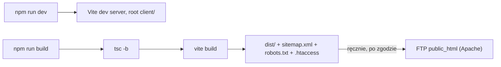

# Szablon projektu na bazie dentalpassion — raport (16.11.2026)

Szablon w `template/` to okrojona kopia architektury [dentalpassion.waw.pl](https://dentalpassion.waw.pl), przygotowana pod nowy projekt **rzadowyprogramklub.pl**. Ma ten sam stack, ten sam sposób pracy lokalnej i ten sam sposób publikacji (pliki z `dist/` na FTP), ale nie zawiera treści klienta, analityki, wersji EN ani kontaktu.

Aby zacząć nowy projekt: skopiuj **zawartość** `template/` do nowego folderu, uruchom `npm install`, uzupełnij miejsca oznaczone `TODO`.

---

## 1. Cel i założenia

- Jednostronicowa aplikacja SPA, wyłącznie pliki statyczne. Bez backendu, bez bazy, bez formularza POST.
- **Lokalnie:** `npm run dev` uruchamia serwer Vite z gorącym przeładowaniem (`http://localhost:5173`).
- **Produkcja:** `npm run build` tworzy `dist/`, którego zawartość wgrywa się ręcznie do `public_html` na hostingu Apache (cyberFolks lub inny z `mod_rewrite`).
- Nawigacja oparta o hash (`#`, `#/404`), więc serwer nie musi znać tras aplikacji. `.htaccess` dba tylko o HTTPS, pliki statyczne i przekierowanie nieznanych ścieżek na widok 404.



## 2. Tech stack

| Paczka | Wersja | Rola |
| --- | --- | --- |
| `vite` | ^8.2 | Bundler i serwer deweloperski. `root` = `client/`, wynik w `dist/` w korzeniu |
| `@vitejs/plugin-react` | ^6.1 | JSX, Fast Refresh |
| `react`, `react-dom` | ^19.2 | UI |
| `typescript` | ^6.0 | Tryb strict; `tsc -b` blokuje build przy błędach typów |
| `tailwindcss`, `@tailwindcss/vite` | ^4.3 | Utility CSS (v4, bez `tailwind.config`) |
| `clsx`, `tailwind-merge` | ^2.1 / ^3.6 | Funkcja `cn()` do łączenia klas |
| `class-variance-authority`, `@radix-ui/react-slot` | ^0.7 / ^1.3 | Fundament komponentów shadcn/ui |
| `lucide-react` | ^1.40 | Ikony (biblioteka ikon shadcn) |
| `framer-motion` | ^13.2 | Animacje (opcjonalnie; `Reveal` działa na CSS + IntersectionObserver) |
| `i18next`, `react-i18next` | ^26.4 / ^17.0 | Teksty UI w `pl.json`; gotowe na kolejny język |
| `vite-imagetools` | ^12.0 | Importy `?url` i `?as=picture` dla grafik |
| `eslint`, `typescript-eslint`, `eslint-plugin-react-hooks`, `eslint-plugin-react-refresh` | ^10.9 / ^8.69 / ^7.1 / ^0.5 | Lint |
| Node | 22 | npm + `package-lock.json` (`npm ci` w CI) |

Usunięte względem dentalpassion: `@radix-ui/react-dialog` (był potrzebny tylko dla jednego komponentu shadcn). Komponenty shadcn dodaje się w razie potrzeby przez `npx shadcn@latest add <nazwa>` — `components.json` jest już skonfigurowany (New York, aliasy `@/components/ui`, `@/lib/utils`).

## 3. Struktura katalogów

```
template/
├── .cursor/
│   ├── rules/                  # shared, frontend, theme, backend, db
│   └── reports/                # raporty po każdym zadaniu (ten plik)
├── client/                     # źródło aplikacji (Vite root)
│   ├── index.html              # head: meta, canonical, OG, Twitter, favicon
│   ├── public/                 # kopiowane 1:1 do dist/
│   │   ├── .htaccess
│   │   └── assets/images/favicon.svg
│   ├── assets/ASSETS.md        # inwentarz grafik
│   └── src/
│       ├── main.tsx            # StrictMode + HashViewProvider + i18n
│       ├── App.tsx             # wybór widoku po hashu, scroll, skip-link
│       ├── index.css           # Tailwind + tokeny :root + import stylów
│       ├── vite-env.d.ts       # typy VITE_* i importów ?url
│       ├── components/
│       │   ├── layout/         # Navbar, Footer, HashLink, DocumentMeta
│       │   ├── pages/          # HomePage, NotFoundPage
│       │   ├── sections/       # bloki wielokrotnego użytku (puste)
│       │   ├── motion/         # Reveal
│       │   └── ui/             # shadcn (puste)
│       ├── config/             # site.ts, theme.ts, assets.ts
│       ├── i18n/               # index.ts, locales/pl.json
│       ├── lib/                # hash-view.tsx, utils.ts, motion.ts
│       └── styles/             # base.css, components.css, pages.css
├── server/.gitkeep             # celowo pusty
├── vite.config.ts              # root, outDir, alias, seoFilesPlugin
├── tsconfig.json / tsconfig.app.json / tsconfig.node.json
├── eslint.config.js
├── components.json             # shadcn
├── package.json
├── .env.example
├── .gitignore
├── KONTEKST.md                 # brief dla kolejnych sesji AI
└── README.md
```

Co gdzie trzymać:

| Plik | Zawartość |
| --- | --- |
| `client/src/config/site.ts` | Fakty: nazwa, URL, później adres, telefon, linki |
| `client/src/config/theme.ts` + `:root` w `index.css` | Kolory i fonty (dwa miejsca, zawsze razem) |
| `client/src/config/assets.ts` | Importy grafik z `client/assets/` |
| `client/src/i18n/locales/pl.json` | Wszystkie teksty UI i meta |
| `client/src/data/*.ts` | (do utworzenia) dane list: wpisy, oferta, zespół |
| `client/public/` | Pliki ze stałym publicznym URL-em |

## 4. Dev vs prod

Komendy z korzenia projektu:

```bash
npm ci            # instalacja z package-lock.json (po pierwszym npm install)
npm run dev       # dev server Vite
npm run build     # tsc -b && vite build → dist/
npm run preview   # lokalny podgląd dist/
npm run lint
```

Zmienne (`.env.example`, kopiujesz do `.env`, którego nie commitujesz):

| Zmienna | Domyślnie | Do czego |
| --- | --- | --- |
| `VITE_BASE` | `/` | Ścieżka bazowa. Zmień tylko, jeśli strona ląduje w podkatalogu (np. `/nowa/`) |
| `VITE_SITE_URL` | `https://rzadowyprogramklub.pl` | Canonical, `og:url`, `sitemap.xml`, `robots.txt` |

W kodzie wyłącznie `import.meta.env.VITE_*`, z sensownym fallbackiem (patrz `site.ts` i `vite.config.ts`). Nowa zmienna = wpis w `.env.example` + typ w `vite-env.d.ts`.

Publikacja na FTP (tylko po zgodzie człowieka):

- Wgraj **zawartość** `dist/` do `public_html` (nie sam folder `dist`).
- `dist/` zawiera: `index.html`, `assets/` (JS, CSS, grafiki z hashem), `.htaccess`, `sitemap.xml`, `robots.txt`, `assets/images/favicon.svg`.
- `.htaccess` jest plikiem ukrytym — upewnij się, że klient FTP go wysyła.
- Nie wrzucaj `node_modules/`, `client/`, `.cursor/`, `.env`.

## 5. Nawigacja hash, `.htaccess` i sitemapa

`client/src/lib/hash-view.tsx` udostępnia:

- `parseHash(hash)` → `{ name, slug? }`; każdy nieznany hash to `notFound`.
- `viewHref(view)` → hash do linku; `hashPath(view)` → ścieżka do canonical.
- `HashViewProvider` i `useHashView()` → `{ view, goTo, scrollTick }`. `scrollTick` rośnie przy kliknięciu linku do bieżącego widoku, żeby `App` przewinął stronę na górę.

`HashLink` to `<a>`, który przy kliknięciu w link do bieżącego widoku wywołuje `goTo` zamiast nic nie robić. Linki `tel:`, `mailto:`, `http` przepuszcza bez zmian.

Checklista nowego widoku (np. `#o-nas`):

1. `client/src/components/pages/AboutPage.tsx` z `<main id="main" tabIndex={-1}>`.
2. `ViewName` + `case "o-nas"` w `parseHash` + `case "about"` w `viewHref`.
3. `case "about"` w `CurrentView` w `App.tsx`.
4. Wpis w `META` w `DocumentMeta.tsx` + klucze `meta.aboutTitle` / `meta.aboutDesc` w `pl.json`.
5. `"#o-nas"` w `HASH_PAGES` w `vite.config.ts`.
6. Pozycja w `NAV` w `Navbar.tsx`.
7. Jeśli stary serwis miał adres `/o-nas.html`: `RewriteRule ^o-nas(\.html)?/?$ /#o-nas [R=301,L,NE]` w `.htaccess`.

`client/public/.htaccess`:

- `Options -Indexes`, `DirectoryIndex index.html`, `ErrorDocument 404 /index.html`.
- Wymuszenie HTTPS z wyjątkiem `/.well-known/` (odnawianie Let's Encrypt).
- `/index.html` → `/` (301), żeby nie dublować adresu.
- Istniejące pliki i katalogi serwowane wprost.
- Każda inna ścieżka → `/#/404` (302), więc stare lub błędne URL-e kończą na widoku 404 z `noindex`.

## 6. Dobre praktyki, które sprawdziły się w dentalpassion

1. **Zakaz zmian na FTP bez zgody.** Agent pisze instrukcję, co wgrać; publikację robi człowiek albo agent po wyraźnym „tak”.
2. **Jedno źródło faktów.** Telefon, adres, godziny, linki żyją tylko w `site.ts`; w tekstach interpolacja `{{phone}}`. Zmiana faktu = jedna edycja.
3. **Tokeny w dwóch miejscach, nigdzie indziej.** `:root` w `index.css` dla CSS i `theme.ts` dla JS. Zero hexów w komponentach — rebranding to podmiana dwóch plików.
4. **Teksty wyłącznie w locale.** Nawet przy jednym języku: dodanie EN to później nowy plik JSON, a nie przepisywanie JSX.
5. **`tsc -b` przed `vite build`.** Błąd typów zatrzymuje build, zanim coś trafi na produkcję.
6. **`assetsInlineLimit: 0`.** Każda grafika jest osobnym plikiem z hashem — przewidywalne cache i brak base64 w JS.
7. **`client/public/` dla stałych URL-i.** `og-image.png`, favicon, pliki weryfikacyjne Google Search Console muszą mieć stały adres; Vite kopiuje je 1:1. Po publikacji nie zmieniać ich ścieżek.
8. **Sitemapa i `robots.txt` generowane przy buildzie** z listy `HASH_PAGES`, z domeną z `VITE_SITE_URL`. Nie ma ręcznie utrzymywanych plików XML.
9. **SEO per widok w SPA.** `DocumentMeta` podmienia title, description, OG, Twitter i canonical; 404 dostaje `noindex,follow` i traci canonical.
10. **Dostępność od startu.** Skip-link, `aria-current` w menu, `aria-expanded` przy hamburgerze, blokada scrolla przy otwartym menu, `prefers-reduced-motion` w `Reveal`, widoczny `:focus-visible`.
11. **Inwentarz grafik (`ASSETS.md`).** Przed dodaniem zdjęcia sprawdzasz, co już jest i gdzie jest użyte.
12. **Raport po każdym zadaniu** w `.cursor/reports/temat_YYYYMMDD.md` + trzy zdania pod `Ostatnie zadania` w `shared.mdc`. Kolejna sesja AI startuje z kontekstem.
13. **`KONTEKST.md` jako brief.** Sekcja „Czego nie robić” chroni przed dokładaniem Expressa, Routera, bazy „na zapas”.
14. **Pusty `server/` z regułą `backend.mdc`.** Jasny sygnał dla agenta, że backendu nie ma i nie ma go stawiać.

Poprawka względem dentalpassion: w oryginale skip-link ma `href="#main"`, co zmienia hash na `main`, a parser traktuje to jako nieznany widok i pokazuje 404. W szablonie skip-link przenosi fokus na `<main tabIndex={-1}>` bez zmiany hasha. Warto przenieść tę poprawkę także do dentalpassion.

## 7. Reguły `.cursor/rules/`

### 7.1. Oryginały z dentalpassion

#### `shared.mdc` (zawsze stosowana)

```markdown
# Nadrzędne zadania

Nigdy nie wprowadzaj zmian na FTP bez zgody użytkownika. Pisz instrukcję co należy zrobić na FTP jeżeli jest taka potrzeba i ewentualnie zapytaj czy masz wyręczyć programistę.


# Cel

Wizytówka gabinetu stomatologii **dentalpassion** (Marcin Mazik) na [dentalpassion.waw.pl](https://dentalpassion.waw.pl).
Jednostronicowa aplikacja SPA bez backendu i bez bazy. Kontakt: `tel:` i `mailto:`, nie formularz POST.

# Stack

- Vite 8 (`root` = `client/`), wynik w `dist/` w korzeniu repo
- React 19 + TypeScript strict (`tsc -b` przed bundlem)
- Tailwind CSS v4 + tokeny w `index.css` `:root` i lustrze `theme.ts`
- shadcn/ui (New York) w `client/src/components/ui/` — bez dzikich zmian stylu
- i18next / react-i18next: PL (domyślny) i EN, wybór w `localStorage`
- npm, `package-lock.json`, Node 22 w CI
- Zmienne wyłącznie `import.meta.env.VITE_*`. Nie commituj `.env`. Nie zgaduj sekretów.

# Publikacja

Jedyna uzgodniona ścieżka: `npm run build` → wrzut **zawartości** `dist/` na FTP (`public_html` na cyberFolks).
Nie dodawaj skryptu FTP, dopóki nie poprosisz. Nie stawiaj Expressa ani MySQL „na zapas”.

# Komunikacja

Z człowiekiem **po polsku**. Identyfikatory w kodzie **po angielsku**.
Treść klienta: `site.ts`, `theme.ts`, `i18n/locales/`. Grafiki: najpierw `client/assets/ASSETS.md`.

# Raporty

Po skończonej pracy dopisz trzy zdania pod `Ostatnie zadania:` (kontekst na kolejną sesję).
Każdy raport: `.cursor/reports/temat_YYYYMMDD.md`.

# Ostatnie zadania

(wpisy dentalpassion)
```

#### `frontend.mdc` (globs `client/**`)

```markdown
# Frontend

- Źródło aplikacji jest wyłącznie w `client/`. Alias `@/` → `client/src`.
- Nawigacja: hash (`#cennik`, `#/rodo`). Bez React Router, dopóki hash + `.htaccess` wystarczają.
- Widoki: home, o-nas, zespół, cennik, blog (+ wpis), kontakt, RODO, prawa pacjenta, polityka, 404.
- Nowa sekcja / strona = plik w `components/pages/` lub `components/sections/`, montaż w `App.tsx`.
- Kotwica w obrębie widoku = `id` na elemencie. Po zmianie hash zamykaj menu mobilne, potem scroll.
- Komponenty UI: shadcn. Nie edytuj stylu „na dziko”. Wygląd marki: istniejące klasy + tokeny, nie rebrand New York.
- SEO: tytuł, description i OG aktualizuj w `index.html` / efekcie widoku. `og:image` to absolutny URL (`/assets/images/og-image.png`).
- Kontakt tylko `tel:` i `mailto:` z `site.ts`. Brak formularza POST.
- Teksty dwujęzyczne: locale, nie twarde stringi w JSX.
- GA4 (`G-55QG7SQY7K`) i Google Ads (`AW-18539018005`): Consent Mode v2, klucz `dentalpassion-consent-v2`, `page_view` po świeżej zgodzie i przy zmianie hash, kliknięcia `tel:` / `mailto:` (`phone_click`, `email_click`) i konwersje w `google-ads.ts`.
```

#### `theme.mdc` (globs `client/src/config/**`)

```markdown
# Motyw i treść

- Kolory i fonty zmieniaj w **dwóch** miejscach: `theme.ts` oraz `:root` w `index.css`.
- Nie rozrzucaj hexów w komponentach.
- Fakty (telefon, adres, mapy, godziny, linki) — `site.ts`, interpolacja w i18n (`{{phone}}`).
- Zdjęcia: `assets.ts` + `client/assets/ASSETS.md`. Kadr: `objectPosition` gdy potrzeba.
```

#### `backend.mdc` (globs `server/**`)

```markdown
# Backend

`server/` jest pusty celowo. Hosting to statyczne pliki na FTP (Apache).
Nie stawiaj Expressa, Dockera ani API, dopóki nie ma takiego wymagania.
```

#### `db.mdc` (na żądanie)

```markdown
Brak bazy danych w tym projekcie
```

### 7.2. Wersje uogólnione w szablonie

Leżą w `template/.cursor/rules/`. Różnice względem oryginałów:

| Reguła | Zmiana |
| --- | --- |
| `shared.mdc` | Frontmatter `alwaysApply: true`; cel jako `TODO`; i18n tylko PL; bez cyberFolks na sztywno; pierwszy wpis w `Ostatnie zadania` o utworzeniu szablonu |
| `frontend.mdc` | Widoki home i 404; pełna checklista nowego widoku (parser, `App.tsx`, `DocumentMeta`, `HASH_PAGES`); `HashLink`; ostrzeżenie przed gołymi `href="#id"`; 404 z `noindex`; bez GA4/Ads i bez kontaktu |
| `theme.mdc` | Fakty ogólne (nazwa, URL, adres, linki), interpolacja `{{name}}` |
| `backend.mdc` | Bez zmian |
| `db.mdc` | Dodany frontmatter i jedno zdanie z zakazem dodawania baz |

## 8. Co celowo pominięto i jak to dodać później

| Funkcja w dentalpassion | Pliki źródłowe w dentalpassion | Jak dodać |
| --- | --- | --- |
| GA4 + Google Ads + Consent Mode v2 | `client/index.html` (gtag z `consent default`), `lib/google-analytics.ts`, `lib/google-ads.ts`, `components/layout/ConsentBanner.tsx`, przycisk „Ustawienia cookies” w `Footer.tsx` | Skopiować pliki, ID przenieść do `VITE_*`, wołać `trackHashPageView` przy zmianie widoku, zaktualizować politykę prywatności |
| Wersja EN | `i18n/locales/en.json`, `readLanguage()` + `localStorage` w `i18n/index.ts`, przycisk `lang-switch` w `Navbar`, `lib/locale.ts` (`pick`) | Dodać `en.json`, przywrócić wybór języka i `og:locale` w `DocumentMeta` |
| Kontakt `tel:` / `mailto:` | `site.ts` (`phoneHref`, `emailHref`), `ContactPage.tsx`, iframe mapy | Dopisać pola w `site.ts` i widok kontaktu. Formularz na Apache wymagałby osobnej decyzji (np. skrypt PHP) |
| Strony prawne (RODO, polityka) | `data/legal.ts`, `LegalPages.tsx` | Potrzebne, gdy pojawi się analityka lub dane osobowe |
| Przekierowania ze starego WordPressa | `client/public/.htaccess` | Dopisać `RewriteRule ... [R=301,L,NE]` przed regułą plików |
| Blog, zespół, cennik | `data/blog.ts`, `data/team.ts`, `data/cennik.ts` + widoki | Wzorzec: dane w `data/`, widok w `pages/`, slug w hashu (`#blog/{slug}`), slug w `HASH_PAGES` |
| Google Fonts | `<link>` w `client/index.html` | Dodać `preconnect` + `<link>` i podmienić `--font-*` oraz `theme.fonts` |
| Weryfikacja Google Search Console | `client/public/googlecd3613b93d6cc0c9.html` | Plik od Google wrzucić do `client/public/`, nie zmieniać nazwy |
| Raporty miesięczne dla klienta | `MonthlyReports/` | Poza zakresem szablonu |

## 9. Uwagi do szablonu

- `.cursorignore` nie został utworzony automatycznie (zapis zablokowany przez ustawienia uprawnień). Skopiuj go ręcznie z korzenia dentalpassion — zawiera `node_modules/`, `dist/`, `.env`, `.env.*`, `!.env.example`, `*.sql`, `*.dump`, `.DS_Store`.
- Placeholdery do uzupełnienia: `TODO` w `index.html`, `pl.json`, `README.md`, `KONTEKST.md`, `shared.mdc`; brakujący `og-image.png` (1200×630) w `client/public/assets/images/`.
- Nowy projekt potrzebuje własnego `git init`; szablon leży w repo dentalpassion tylko jako źródło do skopiowania.
